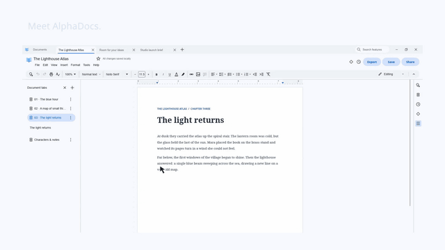

# AlphaDocs

**A familiar document editor. Completely offline.**

Built with Rust · AI-Free editing · Offline documents  
**AlphaDocs by Alpha Workroom**


## See it in action

[](screenshots/AlphaDocs-30s.mp4)

[Watch the 30-second trailer with sound](screenshots/AlphaDocs-30s.mp4) · 1080p / 60 fps MP4. Follow the cursor through real chapter tabs, open documents, direct LAN/VPN sharing and a switch into dark mode. Smooth camera close-ups, click feedback and snapping panels now have longer pauses for reading, with original music and click/swish/snap sound design. The GIF above is a silent preview.


Try the editable examples: [the book](examples/documents/The%20Lighthouse%20Atlas.adocs), [the illustrated guide](examples/documents/Room%20for%20your%20ideas.adocs), or [the project brief](examples/documents/Studio%20launch%20brief.adocs). Download the raw `.adocs` file, then open it in AlphaDocs.

## Download

Get installers and portable builds from [GitHub Releases](https://github.com/AlphaWorkroom/AlphaDocs/releases/latest).

| Platform | Installer | Portable |
| --- | --- | --- |
| Windows 10/11, 64-bit | [Windows Setup](https://github.com/AlphaWorkroom/AlphaDocs/releases/latest/download/AlphaDocs-Windows-x86_64-Setup.exe) | [ZIP](https://github.com/AlphaWorkroom/AlphaDocs/releases/latest/download/AlphaDocs-Windows-x86_64-Portable.zip) |
| Linux, x86-64, Ubuntu 22.04+ / compatible Debian systems | [DEB](https://github.com/AlphaWorkroom/AlphaDocs/releases/latest/download/AlphaDocs-Linux-x86_64.deb) | [tar.gz](https://github.com/AlphaWorkroom/AlphaDocs/releases/latest/download/AlphaDocs-Linux-x86_64.tar.gz) |
| macOS 14+, Apple silicon | [DMG](https://github.com/AlphaWorkroom/AlphaDocs/releases/latest/download/AlphaDocs-macOS-aarch64.dmg) | [App bundle](https://github.com/AlphaWorkroom/AlphaDocs/releases/latest/download/AlphaDocs-macOS-aarch64.tar.gz) |
| macOS 14+, Intel | [DMG](https://github.com/AlphaWorkroom/AlphaDocs/releases/latest/download/AlphaDocs-macOS-x86_64.dmg) | [App bundle](https://github.com/AlphaWorkroom/AlphaDocs/releases/latest/download/AlphaDocs-macOS-x86_64.tar.gz) |

The Windows installer requires .NET Framework 4.8. Downloads include the app, its licence and dependency notices; Rust is needed only to build from source. macOS DMGs use drag-to-Applications installation. The app is ad-hoc signed and **not Apple-notarised**, so macOS may still require its per-app Open Anyway approval. See [installation and platform notes](docs/INSTALLATION.md).

## Features

New in 0.1.9: recent-document cards wrap neatly within the homepage, including after resizing. See the [editor audit and compatibility limits](docs/EDITOR_COMPATIBILITY.md).


### Multiple documents. One window.

Keep multiple documents open using tabs, without needing separate windows. Each document keeps its own selection, undo history and save state. Organise sections with document-content tabs in the sidebar.


### Every chapter. One book.

Give chapters their own content tabs inside a single document. Keep character notes and research alongside the story, and use the heading outline to jump to a section. The example below uses serif body text, a chapter title and a small blue running label.


### From a first draft to a finished brief.

Use your own type, colour and spacing. Add an editable table for a project plan, or combine headings, text and pictures in an illustrated guide.


### Tired eyes? Switch to dark mode!

Choose Light, Dark or your operating system's appearance in Preferences. Keep the same document, tools and layout while changing the workspace theme.

### Crop to Transparency

Automatically remove invisible image borders without permanently changing the original image. Adjust crop, transparent padding, opacity, brightness and contrast, or reset the image later.


### Share directly with other people.

Start an encrypted sharing session and privately send an invitation with **edit** or **view** access. Work on the same document with live edits and collaborator selections, or let someone read it while you write. Each participant retains a local document copy.

Sharing currently needs a reachable **LAN or VPN**, and the host must keep AlphaDocs open. It does not use hosted cloud storage, account sign-in or email delivery. [How direct sharing works](docs/COLLABORATION.md).


### Your documents stay yours.

Write and edit completely offline, without relying on cloud services, an account or an AI writing service. Native **`.adocs`** files retain editable formatting, content tabs, original pictures and local annotations. Local autosave is optional and waits for 30 seconds without editing; Save and version history keep work on your computer.

### Familiar tools, native performance.

- Measured pages with 11 paper presets, custom dimensions and pageless view; headings, lists, links, editable tables and find/replace.
- Interactive checklists, whole table-row/column selection, custom colour wheel and pinned palettes.
- Local signature requests with typed/drawn signatures, returned response files and completed PDFs. [Signing workflow](docs/SIGNING.md).
- Built-in offline English voice typing after explicit first-use runtime/model setup. [Speech details](docs/SPEECH_BACKEND.md).
- Manual citations and bibliographies, text comparison reports, measured line numbers and optional typing substitutions.
- Offline Australian English spelling and basic grammar checks, with squiggles and right-click suggestions.
- Reversible image editing, wrap/behind/front placement and measured alignment guides.
- Text/image comments, replies, local reactions and emoji insertion.
- Light/dark/system appearance, feature search and keyboard shortcuts.
- Native `.adocs`, DOCX and plain-text opening; `.adocs`, DOCX, PDF, ODT, TXT, RTF, zipped HTML, EPUB and Markdown downloads.
- Native Windows printing with driver capabilities and preview; PDF preparation on other platforms.
- Optional encrypted direct-peer sharing on a LAN/VPN, without an AlphaDocs account or hosted backend. [Read the collaboration scope](docs/COLLABORATION.md).

[Full changelog](CHANGELOG.md) · [Writing tools and online-service limits](docs/WRITING_TOOLS.md).

Document editing needs no connection. Public GitHub update checks are enabled by default, run at most once a day and can be disabled in Preferences. **Help → Check for updates** checks manually. Update checks request release metadata only. Voice typing downloads its runtime and English model once (about 46–55 MB), then recognises speech locally without uploading audio or document text. Online dictionary lookup sends just the searched word; document translation is hidden unless enabled in Preferences and sends text only when you click Translate. From 0.1.3 onward, Download and install shows byte progress while downloading, saves open work, verifies the installer and restarts the updated app. Windows keeps a helper window visible during installation; macOS and Linux close AlphaDocs while a background helper installs, then reopen it (the OS may show an authorization prompt). Unsupported portable locations show a manual-download route. Older versions need this installer once to gain the new updater. See [update and recovery details](docs/UPDATES.md).

## Compatibility

AlphaDocs is a native Rust desktop application, with no Electron, embedded browser or web editor. Its own measured layout is shared by the canvas and PDF export.

DOCX/HTML interchange supports a documented subset, rather than every Word/browser layout. Rotation, true inline image atoms, merged/nested tables, tracked changes, broad language analysis and macOS/Linux native printer backends are not implemented. Additional export formats do not imply corresponding import support. TXT omits formatting/pictures; web/EPUB reflow, and Markdown uses a companion picture folder. Interfaces and fonts can vary between operating systems.

Release CI builds and tests native installers for each listed platform. Windows has visual interaction QA; automated cross-platform checks are not a claim of identical rendering on every device.

## Build and contribute

```sh
git clone https://github.com/AlphaWorkroom/AlphaDocs.git
cd AlphaDocs
cargo build --locked --release
```

See [development and release instructions](docs/DEVELOPMENT.md) for native dependencies, tests, packaging and the release workflow. Keep build caches out of distribution archives. Report bugs and request features through [GitHub Issues](https://github.com/AlphaWorkroom/AlphaDocs/issues).

## Licence

Copyright © 2026 **Alpha Workroom**. Distributed under the supplied [AlphaDocs Free Use & Non-Monetisation Licence, Version 1.1](LICENSE).

Ordinary personal, educational, workplace and business use is permitted, including earning income from documents you create. Selling or monetising the software itself requires written permission; public downloadable copies must be distributed through GitHub. The full licence controls. This is a source-available project under custom terms, rather than a claim of an OSI-approved open-source licence.

Third-party components retain their own licences. Fonts, dictionary and artwork notices are in `assets/` and `licenses/`; resolved dependency notices and required source archives accompany packaged downloads. AlphaDocs and Alpha Workroom branding remain with their rights holders.

## Feedback and bug reports

[Send feedback or report a bug](https://docs.google.com/forms/d/e/1FAIpQLSczvu4GiVbR1PXFWfW_arILYPqBVQKb5kq7uisTbHpCYZ60KQ/viewform?usp=publish-editor). This same Google Form is available in **Help → Send feedback or report a bug**. Include your AlphaDocs version, operating system, what you tried, what you expected, and what happened. Screenshots and a small non-sensitive example help us reproduce a problem. The app opens the form in your browser and does not upload your documents automatically.

### Invite a nearby computer

To invite someone into live editing, open **Share** on both computers, enter each person's display name and choose **Make this device visible**. On the host, start sharing, choose **Can edit** or **Can view**, then click **Invite** beside the other device. The receiver chooses **Join** or **Decline**. Both need this version of AlphaDocs. Nearby visibility is opt-in and stays on until stopped or the app closes. Discovery broadcasts only the chosen name, device type and temporary ID; private invitations travel over an encrypted, device-key-pinned connection. Names are not verified identities—compare the short device IDs on the two computers. Local discovery may be blocked by VPNs, firewalls or isolated Wi-Fi; the existing copy/paste invitation still works. This is live collaboration, not Apple's AirDrop or independent file transfer.

The **Working together** strip names connected people and their current content tabs. Its colours match the larger caret/selection labels in the document. A label marks a person's selection or caret; it is not a claim that they are currently typing.
